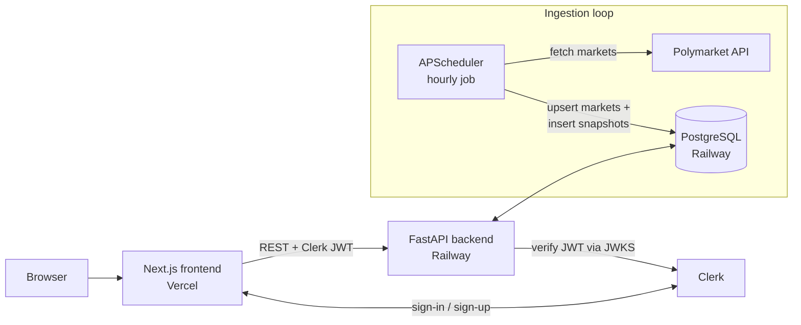

# Prediction Market Analytics

A full-stack analytics platform for prediction markets. It ingests live market data from Polymarket every hour and stores the history in a time series. Users can browse markets, chart how probabilities move over time, spot the biggest movers and keep personal watchlists.

<!-- TODO: add once deployed / recorded:
**Live demo:** [your-app.vercel.app](https://your-app.vercel.app) · **Demo video:** [2-minute walkthrough](https://link-to-video)

-->

---

## Features

- **Automated data ingestion.** A background scheduler pulls active markets from Polymarket's public API every hour. Each run upserts the markets and records a probability snapshot, and it runs unattended in production.
- **Historical probability charts.** Interactive line charts show how each market's probability has changed over 24H, 7D, 30D or 90D. The y-axis fits the data (at least a 10-point range), so small moves stay visible, and when the history is shorter than the selected range the page says how far back it goes, in the viewer's time zone.
- **Biggest movers dashboard.** The home page shows the biggest risers and fallers over the last 24 hours, plus trending markets by volume.
- **Market browser.** Search markets by question or category, filter by category, sort by volume, liquidity, probability, end date or last update, and page through the results.
- **Authentication.** Sign-up and sign-in use Clerk. The backend verifies Clerk JWTs against Clerk's JWKS.
- **Personal watchlists.** Signed-in users can save markets and manage their own watchlists.
- **Public browsing.** Anyone can view the market list and market detail pages without an account. Only watchlists require auth.

---

## Tech Stack

| Layer | Technologies |
|---|---|
| **Frontend** | Next.js 16 (App Router), React 19, TypeScript, Tailwind CSS 4, shadcn/ui, Recharts |
| **Backend** | FastAPI, Python 3.12, Pydantic, SQLAlchemy, Alembic |
| **Database** | PostgreSQL 16 |
| **Scheduling** | APScheduler |
| **Auth** | Clerk |
| **Infra** | Docker, Docker Compose, GitHub Actions |
| **Deployment** | Vercel (frontend), Railway (backend + PostgreSQL) |

---

## Architecture



**Design notes:**

- **Server Components for reads.** Market pages fetch data on the server in Next.js, so most pages don't need client-side `useEffect` fetching.
- **The backend is a long-running process, not serverless.** APScheduler runs inside the FastAPI process, so the backend is deployed on Railway as a persistent service. That keeps the hourly ingestion job alive.
- **Markets and snapshots are separate tables.** A `Market` row holds the market's current metadata. `MarketSnapshot` rows record the probability at each hourly run (one-to-many). The snapshot table powers the charts and the movers dashboard.
- **Ingestion is fault tolerant.** Each run is logged and wrapped in error handling, so a bad API response doesn't crash the scheduler.
- **Restarts don't add extra snapshots.** On startup the scheduler looks at the last real ingestion run (seeded data doesn't count). If it was less than one interval ago, the first run waits until that interval is up; otherwise it runs about 10 seconds after startup. Deploys and dev-server reloads therefore don't pile up snapshots minutes apart and skew the movers.

### Data model

```
User ──< Watchlist ──< WatchlistItem >── Market ──< MarketSnapshot
```

---

## API Overview

| Method | Endpoint | Auth | Description |
|---|---|---|---|
| `GET` | `/health` | — | Health check |
| `GET` | `/markets` | — | Paginated market list (`?q=&category=&active=true&sort=volume\|liquidity\|probability\|ending\|updated&limit=24&offset=0`) |
| `GET` | `/markets/movers` | — | Biggest probability changes (`?hours=24&limit=10&direction=up\|down\|any`) |
| `GET` | `/markets/categories` | — | Categories with market counts |
| `GET` | `/markets/{id}` | — | Market detail |
| `GET` | `/markets/{id}/snapshots` | — | Probability snapshots for charting (`?days=30`, up to 365) |
| `GET` | `/watchlists` | ✅ | List the current user's watchlists |
| `POST` | `/watchlists` | ✅ | Create a watchlist |
| `DELETE` | `/watchlists/{id}` | ✅ | Delete a watchlist |
| `POST` | `/watchlists/{id}/items` | ✅ | Add a market to a watchlist |
| `DELETE` | `/watchlists/{id}/items/{market_id}` | ✅ | Remove a market from a watchlist |

FastAPI generates interactive docs at `/docs` in development. They are turned off in production (`DOCS_ENABLED=false`).

---

## Getting Started

### Prerequisites

- [Docker](https://docs.docker.com/get-docker/) and Docker Compose
- A free [Clerk](https://clerk.com) application (for auth keys)
- Optional, for running without Docker: Node.js 22 and Python 3.12

### 1. Clone the repo

```bash
git clone https://github.com/<your-username>/prediction-market.git
cd prediction-market
```

### 2. Configure environment variables

Each `.env.example` lists every setting with its default. Copy them and fill in your values. The copies are git-ignored; never commit them.

```bash
cp .env.example .env                      # POSTGRES_PASSWORD for docker compose
cp backend/.env.example backend/.env      # Clerk JWKS URL, issuer, ingestion settings
cp frontend/.env.example frontend/.env.local   # Clerk keys
```

- **`.env`**: set `POSTGRES_PASSWORD` to a random value, e.g. `openssl rand -hex 24`. Compose refuses to start without it.
- **`backend/.env`**: set `CLERK_JWKS_URL`, `CLERK_ISSUER` (your Clerk Frontend API URL) and `CLERK_AUTHORIZED_PARTIES` (`http://localhost:3000` locally).
- **`frontend/.env.local`**: set `NEXT_PUBLIC_CLERK_PUBLISHABLE_KEY` and `CLERK_SECRET_KEY`. Leave both empty to run without sign-in: public pages work and the watchlist page says sign-in isn't configured.

`API_URL` is only used by the Next.js server. The browser never calls the API directly, so the backend URL and session tokens stay server-side.

### 3. Run everything with Docker Compose

```bash
docker compose up --build
```

| Service | URL |
|---|---|
| Frontend | http://localhost:3000 |
| Backend API | http://localhost:8000 |
| API docs | http://localhost:8000/docs |

All ports are bound to `127.0.0.1`, so nothing is exposed to your network.

### 4. Run database migrations and seed data

```bash
docker compose exec backend alembic upgrade head
docker compose exec backend python seed.py
```

The seed adds sample markets with a week of history so the UI isn't empty right away. Real Polymarket data starts arriving with the first ingestion run, about 10 seconds after the backend starts on a fresh database and then every hour (`INGESTION_INTERVAL_MINUTES`). If a real run happened less than an interval ago, restarting the backend waits for the next scheduled run instead. Seeded markets are marked inactive once real data arrives.

### 5. Run the tests

```bash
docker compose run --rm backend pytest
```

### Running without Docker (optional)

```bash
# Backend
cd backend
python -m venv .venv && source .venv/bin/activate
pip install -r requirements-dev.txt
alembic upgrade head
uvicorn main:app --reload

# Frontend (in a second terminal)
cd frontend
npm install
npm run dev
```

You still need PostgreSQL. Run just the database with `docker compose up -d postgres` and set `DATABASE_URL` in `backend/.env` (see the example file).

---

## Project Structure

```
prediction-market/
├── frontend/              # Next.js app (App Router, TypeScript)
│   ├── app/               # Routes: /, /markets, /markets/[id], /watchlist; Server Actions
│   ├── components/        # UI components (shadcn/ui, Recharts charts)
│   ├── public/            # Static files (robots.txt, apple-touch-icon)
│   ├── lib/               # Server-only API client, auth helper, formatting
│   └── proxy.ts           # Per-request CSP nonce + route protection
├── backend/               # FastAPI app
│   ├── main.py            # App entrypoint + scheduler startup
│   ├── models/            # SQLAlchemy models
│   ├── routers/           # API routes
│   ├── ingestion/         # Polymarket client, ingest job, scheduler
│   ├── auth/              # Clerk JWT verification dependency
│   ├── alembic/           # Database migrations
│   ├── tests/             # pytest suite
│   └── seed.py            # Sample data for local development
├── .github/workflows/     # CI: lint, test, build and dependency audit on every push
├── docker-compose.yml
└── README.md
```

---

## CI/CD

- **GitHub Actions** lints, tests and builds the frontend and backend on every push, and audits runtime dependencies for known vulnerabilities. Dependabot opens weekly update PRs.
- **Vercel** deploys the frontend automatically from `main`.
- **Railway** hosts the FastAPI backend as a persistent service, next to a managed PostgreSQL instance.

### Production configuration

The backend's production image (`docker build --target prod backend`) runs migrations on start, serves on `$PORT` and runs as an unprivileged user. Set these on Railway:

| Variable | Value |
|---|---|
| `DATABASE_URL` | Railway's PostgreSQL URL (`postgres://` URLs are accepted) |
| `CLERK_JWKS_URL` | `https://<your-clerk-domain>/.well-known/jwks.json` |
| `CLERK_ISSUER` | `https://<your-clerk-domain>` |
| `CLERK_AUTHORIZED_PARTIES` | Your frontend origin, e.g. `https://your-app.vercel.app` |
| `FORWARDED_ALLOW_IPS` | `*` (Railway's proxy sets `X-Forwarded-For`; needed for per-client rate limiting) |

With `APP_ENV=production` (the image default) the backend refuses to start if any Clerk setting is missing or the database isn't PostgreSQL. Run a single instance: the scheduler lives in the API process, and an advisory lock keeps overlapping runs from double-counting.

On Vercel, set `API_URL` (the Railway backend URL), `NEXT_PUBLIC_CLERK_PUBLISHABLE_KEY` and `CLERK_SECRET_KEY`.

---

## Security

- **Authentication**: the backend verifies Clerk session JWTs itself: RS256 only, signature against Clerk's JWKS, expiry, issuer and authorized party (`azp`). Tokens signed with other algorithms or keys are rejected.
- **Authorization**: every watchlist query is scoped to the signed-in user. Another user's watchlist returns 404, so its existence isn't revealed.
- **No tokens in the browser's API calls**: the frontend calls the API from the Next.js server (pages and Server Actions). Server Actions validate their inputs and are protected by Next.js's same-origin check.
- **Input validation**: every query parameter and request body is bounded and validated; search wildcards are escaped. Unknown fields are rejected.
- **Untrusted upstream data**: Polymarket responses are size-capped and validated entry by entry; only `https` image URLs are kept, and images load through Next.js's optimizer from an allow-listed host.
- **Headers**: a strict, nonce-based Content-Security-Policy with `strict-dynamic`, plus HSTS, `X-Frame-Options: DENY`, `nosniff` and a restrictive referrer policy. The API sends `default-src 'none'` and `Cache-Control: no-store` on per-user data.
- **Abuse limits**: per-IP rate limiting on the API (`RATE_LIMIT`), and caps of 20 watchlists per user and 200 markets per watchlist.
- **Secrets**: only in uncommitted env files or the hosting provider's settings. Variables prefixed `NEXT_PUBLIC_` reach the browser, so no secret uses that prefix.
- **Containers**: production images run as UID 10001; local ports bind to `127.0.0.1` only.

---

<!-- TODO: add screenshots under docs/screenshots/ and restore this section.
## Screenshots

| Markets | Market detail + chart | Watchlist |
|---|---|---|
|  |  |  |
-->

---

## Roadmap

- [ ] **Price alerts.** Users set a probability threshold on a market. After each ingestion run the backend checks the thresholds and sends an email through [Resend](https://resend.com) when one is crossed.
- [ ] More data sources beyond Polymarket
- [ ] More analytics (volatility, volume trends)

---

## Data Source

Market data comes from [Polymarket](https://polymarket.com)'s public API. This project isn't affiliated with Polymarket.
